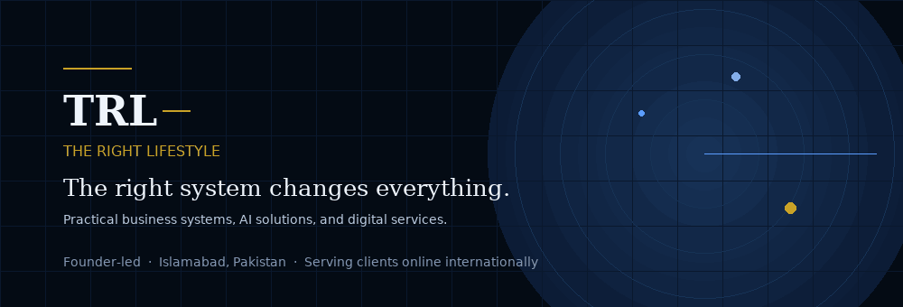
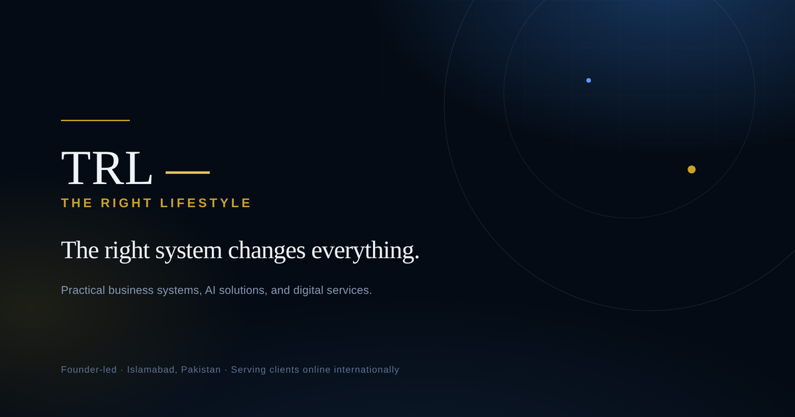
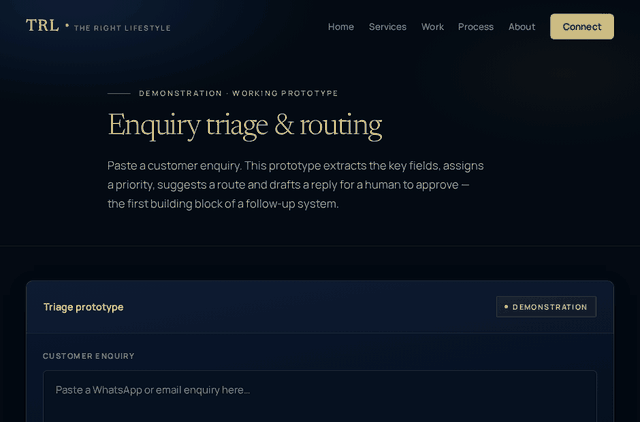

<p align="center">
  
</p>

<p align="center">
  <strong>Founder-led business systems, AI solutions &amp; digital services · Islamabad, Pakistan</strong>
</p>

<p align="center">
  <a href="https://therightlifestyle.github.io/TRL/">🌐 Live Website</a>
  &nbsp;·&nbsp;
  <a href="https://therightlifestyle.github.io/TRL/services.html">Services &amp; Capabilities</a>
  &nbsp;·&nbsp;
  <a href="https://therightlifestyle.github.io/TRL/portfolio.html">Demonstrations &amp; Work</a>
  &nbsp;·&nbsp;
  <a href="https://therightlifestyle.github.io/TRL/how-we-work.html">How We Work</a>
  &nbsp;·&nbsp;
  <a href="https://therightlifestyle.github.io/TRL/about.html">About</a>
  &nbsp;·&nbsp;
  <a href="https://wa.me/923190091457">💬 WhatsApp</a>
  &nbsp;·&nbsp;
  <a href="mailto:officialtrlservice@gmail.com">✉️ Email</a>
</p>

---

## Meet the founder

<p align="center">
  
</p>

I’m **Rashid Muhammad**, founder of **TRL — The Right Lifestyle**.

TRL is a founder-led company based in Islamabad, Pakistan, serving owner-operated businesses across Pakistan and internationally online. We design and implement practical business systems, workflow automation, and custom digital services — replacing manual, repetitive chaos with durable, documented processes that continue running smoothly when you are not in the room.

We start with the actual business friction first. Only once the workflow, bottleneck, and desired outcome are defined do we select the right tools and build the solution.

> **"The right system changes everything."**

---

## What TRL builds

TRL operates across seven practical service disciplines:

| Discipline | What we deliver |
|---|---|
| **01 · AI &amp; Automation** | Intelligent enquiry routing, customer messaging flows, internal triaging, document summarisation, and scheduled background jobs. |
| **02 · Websites &amp; Digital Products** | High-performance, zero-bloat static websites, custom client portals, and bespoke web interfaces built for conversion and trust. |
| **03 · Research &amp; Market Intelligence** | Competitor audits, market mapping, tooling evaluations, and structured feasibility briefs for new initiatives. |
| **04 · Business Strategy &amp; Systems** | Operating manuals, standard operating procedures (SOPs), process documentation, handover guides, and business tracking registers. |
| **05 · Marketing &amp; Content Systems** | Publishing cadences, structured content pipelines, lead capture funnels, and automated follow-up sequences. |
| **06 · Software &amp; Integrations** | Custom scripts, API connectors, spreadsheet automations (Google Sheets / Excel), and webhooks connecting disparate tools. |
| **07 · Consultation &amp; Direction** | Technical guidance, architecture advisory, vendor evaluations, and fractional systems leadership for business owners. |

---

## Interactive demonstration — Enquiry triage &amp; routing

<p align="center">
  
</p>

<p align="center">
  <em>Live working prototype: converts messy customer messages into structured, prioritized records with a draft human-approved reply.</em>
</p>

Experience the prototype directly in your browser:  
👉 **[Open the Live Demonstration Prototype](https://therightlifestyle.github.io/TRL/lead-triage.html)**

- **100% Client-Side:** Runs entirely in your browser using pure JavaScript.
- **Privacy First:** Zero API calls, zero server transmission, and zero data logging. Nothing typed is stored or sent.
- **Real Workflow:** Automatically detects sender name, business, urgency, intent category, order/ticket references, and drafts a human-ready reply.

---

## Rapid AI Opportunity Audit

Our introductory fixed-scope diagnostic engagement for owner-operated businesses:

- **Price:** **PKR 3,000** (Single fixed-fee engagement)
- **Turnaround:** 3–5 working days
- **Deliverables:**
  1. Complete operational friction map of your top time-drains.
  2. Prioritised matrix of automation opportunities ranked by impact vs effort.
  3. Actionable implementation roadmap with recommended tooling and estimated ROI.
  4. 30-minute founder walkthrough call to answer questions.

No upsell pressure, no retainers required. You own the diagnostic memo and can implement it yourself or with any partner.

---

## How we work — Four-stage process

```
┌─────────────────┐     ┌─────────────────┐     ┌─────────────────┐     ┌─────────────────┐
│ 01 CONVERSATION │ ──> │  02 DEFINITION  │ ──> │    03 BUILD     │ ──> │   04 HANDOVER   │
│ Honest problem  │     │ Written scope & │     │ Staged build in │     │ Complete docs,  │
│ exploration     │     │ clear deliverables│   │ visible phases  │     │ assets & control│
└─────────────────┘     └─────────────────┘     └─────────────────┘     └─────────────────┘
```

1. **Conversation:** A focused discovery discussion about your operations, bottlenecks, and objectives.
2. **Definition:** Scope, milestones, timeline, and exact deliverables agreed in writing before any build begins.
3. **Build:** Transparent, staged execution with regular progress demos and no black-box surprises.
4. **Handover:** Full ownership transfer — you keep all accounts, source code, documentation, and operational independence.

---

## Honest by default — Non-negotiable boundaries

- **No fabricated credibility:** No fake client testimonials, invented logos, fictitious team members, or inflated revenue claims.
- **Labelled honestly:** Prototypes and mockups are explicitly marked as `Demonstration` or `Sample deliverable`.
- **Complete client ownership:** You own 100% of your data, accounts, credentials, and code. No vendor lock-in.
- **Security &amp; privacy:** Zero passwords in chats or unencrypted files. No unsolicited bulk messages or spam.
- **Pragmatic advice:** If an off-the-shelf free tool solves your problem, or if automation is unnecessary, we will tell you upfront.

---

## Repository architecture &amp; tech stack

This repository contains the official production codebase for the TRL website, built according to our **"Systems Studio"** design standard:

- **Architecture:** Zero-build static site. Zero server runtime, zero framework dependencies, zero trackers, and **zero external network requests**.
- **Typography:** Self-hosted [Newsreader](https://fonts.google.com/specimen/Newsreader) (editorial serif) and [Manrope](https://fonts.google.com/specimen/Manrope) (geometric sans) as self-hosted `.woff2` variable fonts with `font-display: swap`.
- **Palette:** Signature deep navy (`#040B14` → `#17375F`) foundation, restrained gold (`#C9A227`), and technical blue (`#5B9DFF`).
- **Theme support:** Built-in Light and Dark theme toggle with persistent preference and automatic system detection.
- **Responsive &amp; Accessible:** 100% WCAG AA contrast compliance, zero horizontal overflow at 320px–1440px+, and full accessibility under `prefers-reduced-motion`.

### File structure

```
therightlifestyle/TRL/
├── index.html                      # Homepage: proposition, capabilities, process, demo showcase, audit
├── services.html                   # 7 service disciplines, pricing philosophy, and audit details
├── portfolio.html                  # Sample deliverables and interactive demonstrations
├── how-we-work.html                # 6-stage engagement lifecycle and commercial terms
├── about.html                      # Purpose, founder background, scoping principles, commitments
├── contact.html                    # Two WhatsApp routes, direct email, and response SLAs
├── lead-triage.html                # Live interactive customer enquiry triage prototype
├── privacy.html                    # Transparent privacy notice
├── terms.html                      # Fair terms of engagement
├── style.css                       # Systems Studio design system & CSS variables (Dark & Light)
├── main.js                         # Progressive enhancements (drawer, scroll stuck, reveals, theme toggle)
├── trl-banner.gif                  # Animated hero profile banner
├── triage-demo.gif                 # Animated enquiry triage demonstration GIF
├── og-image.png                    # 1200×630 Open Graph & social card asset
├── favicon.svg                     # High-resolution vector brand mark
├── manrope-normal-latin.woff2      # Self-hosted interface font (regular)
├── manrope-normal-latin-ext.woff2  # Self-hosted interface font (extended latin)
├── newsreader-normal-latin.woff2   # Self-hosted display serif font (regular)
├── newsreader-normal-latin-ext.woff2 # Self-hosted display serif font (extended latin)
├── newsreader-italic-latin.woff2   # Self-hosted display serif font (italic)
├── robots.txt                      # Search crawler directives
├── sitemap.xml                     # Search index sitemap
├── .nojekyll                       # GitHub Pages raw static serving directive
├── .gitignore                      # Git exclusion rules
├── .gitattributes                  # LF line endings & binary file attributes
├── .editorconfig                   # Editor standards
├── LICENSE                         # Proprietary source & copyright declaration
├── CHANGELOG.md                    # Release history and audit log
├── DEVELOPMENT.md                  # Developer manual and quality assurance checklist
└── DEPLOYMENT.md                   # Production deployment manual
```

---

## Local development &amp; preview

Clone the repository and serve it locally with Python's built-in HTTP server:

```bash
git clone https://github.com/therightlifestyle/TRL.git
cd TRL
python3 -m http.server 8000
```

Open `http://localhost:8000` in any modern browser.

Because all internal links and asset paths are relative, files can also be previewed directly via `file://`.

---

## Quality assurance &amp; audit status

| Audit check | Status | Specification |
|---|---|---|
| **Zero external requests** | ✅ PASS | All fonts, CSS, JS, and graphics are self-hosted |
| **HTTP status codes** | ✅ PASS | All internal pages, scripts, fonts, and images return 200 OK |
| **Console errors** | ✅ PASS | 0 errors, 0 warnings across all 9 pages |
| **Mobile responsiveness** | ✅ PASS | 0px horizontal overflow from 320px to 1440px |
| **Dual theme support** | ✅ PASS | Navy Systems Studio Dark + Clean Light theme toggle |
| **Typography loading** | ✅ PASS | Self-hosted WOFF2 with local fallbacks |
| **Structured data** | ✅ PASS | Valid Schema.org `ProfessionalService` JSON-LD |
| **Nojekyll flag** | ✅ PASS | `.nojekyll` present to bypass Jekyll processing |

---

## Connect with TRL

- **Website:** [therightlifestyle.github.io/TRL](https://therightlifestyle.github.io/TRL/)
- **WhatsApp:** [+92 319 0091457](https://wa.me/923190091457)
- **Email:** [officialtrlservice@gmail.com](mailto:officialtrlservice@gmail.com)
- **Hours:** Monday – Saturday, 10:30 to 18:30 PKT
- **Location:** Islamabad, Pakistan · Serving clients online internationally

<br>
<p align="center">
  <strong>The right system changes everything. 🤝</strong><br>
  <sub>© 2026 Rashid Muhammad · TRL — The Right Lifestyle. All rights reserved.</sub>
</p>
